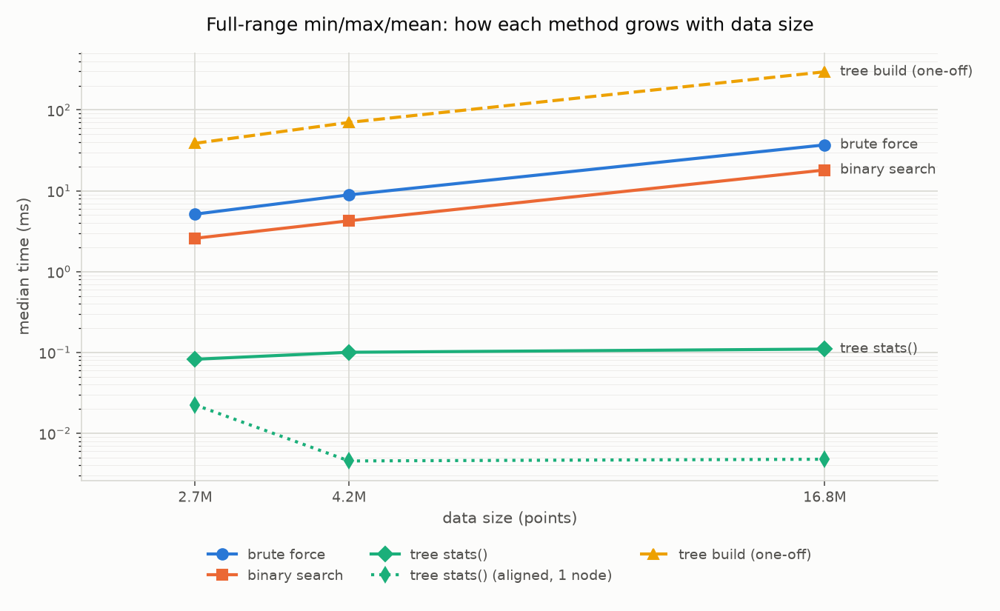

# Grid Frequency Explorer

Fast zooming and event search over 2.7 million readings of Great Britain grid frequency
(August 2019), using a segment tree of precomputed summaries.

**Question:** How many times did GB grid frequency leave its statutory limits in August 2019,
and what did the 9 August power cut look like?

**Answer:** Once. On 9 August at 15:52 UTC (16:52 UK time), frequency fell to **48.787 Hz** and
stayed outside the 49.5–50.5 Hz band for 142 seconds. The tree found it by visiting 323 nodes
instead of scanning 2.7 million points.

---

## Data

- **Source:** [NESO historic system frequency data](https://www.neso.energy/data-portal/system-frequency-data),
  1-second resolution, August 2019. The data isn't included in this repo because of its size.
  Download the August 2019 file from that page and put it in `data/raw/` (`.csv` or `.zip`).
  Cached arrays in `data/processed/` are built automatically on the first run.
- **Limits:** NESO must keep frequency within ±0.5 Hz of 50 Hz
  ([NESO](https://www.neso.energy/data-portal/system-frequency-data)), so the event band is
  **49.5–50.5 Hz**.
- **Quality:** a complete month: 2,678,400 readings, no gaps or duplicates.
- **Timezone:** raw timestamps are UK summer time (+01:00). Everything is converted to UTC on
  load and stays UTC through the API and the dashboard.

---

## How it works

Every power-of-two window of the data stores a summary: min, max, sum and count. Any time range
can then be answered from about 2 × log₂(N) summaries instead of the raw readings.

```
level 3   [             v0 - v4             ]
level 2   [       v0 - v3         ] [   v4    ]
level 1   [ v0 - v1 ] [ v2 - v3 ] [   v4    ]
level 0     v0   v1     v2   v3      v4          raw data (N = 5)
```

- `query()` picks the level whose window size fits the visible range into the chart's pixel
  width, so drawing cost depends on screen width, not on how much time is shown.
- `stats()` combines the fewest whole windows that exactly cover a range, for exact
  min / max / mean.
- Event search skips any window whose min and max are both inside the band, without reading
  the data beneath it.

Design choices:

- **No padding to a power of two.** The last window at each level may be partial, which costs
  23 extra slots in total instead of ~1.5 million.
- **Level 0 is the raw array**, not a copy.
- **`sum` is float64.** Summing 2.7M float32 values in float32 visibly skews the mean.
- **Gaps stay NaN** and are excluded from statistics, never interpolated.

The tree has 23 levels, takes 53.6 MB (5× the raw data, since each summary holds four numbers)
and builds in 39 ms.

---

## Results

| Start (UTC) | Duration | Lowest | At (UTC) | Recovery | Max RoCoF |
|---|---|---|---|---|---|
| 2019-08-09 15:52:38 | 142 s | **48.787 Hz** | 15:53:49 | 71 s | 0.151 Hz/s |

```
15:52:28   50.010   normal
15:52:38   49.468   leaves the band
15:52:58   49.120   first plateau
15:53:49   48.787   lowest point
15:55:00   49.5+    back inside the band
```

The shape matches the official account. The
[ESO's technical report](https://www.ofgem.gov.uk/sites/default/files/docs/eso_technical_report_-_final.pdf)
describes the fall being held at about 49.1 Hz before further generation losses pushed it to
48.8 Hz, where Low Frequency Demand Disconnection automatically cut about 5% of demand.
The month's highest reading was 50.274 Hz, so the only excursion was downward.

Max RoCoF (rate of change of frequency) is a lower bound: 1-second readings are too coarse to
capture how fast frequency actually moved.

---

## Performance

Median of 50 runs on the real month, random start positions. Times in milliseconds.

| Range | Brute force | Binary search | Tree | Tree nodes |
|---|---|---|---|---|
| 1 minute | 1.007 | **0.013** | 0.022 | 7 |
| 1 hour | 1.339 | **0.018** | 0.045 | 12 |
| 1 day | 1.445 | 0.089 | **0.052** | 14 |
| 1 week | 2.007 | 0.540 | **0.058** | 18 |
| Full month | 4.590 | 2.308 | **0.022** | 9 |

The tree loses on short ranges: slicing 60 numbers with numpy is cheaper than walking 7 nodes
in Python. It wins from about one day up, and is ~100× faster than binary search on the full
month. That's Python overhead, not the algorithm.

Growth with data size is the real argument:

| Points | Tree build | Tree | Binary search | Brute force |
|---|---|---|---|---|
| 2,678,400 | 39 ms | 0.082 (35 nodes) | 2.58 | 5.14 |
| 4,194,304 | 70 ms | 0.101 (42 nodes) | 4.25 | 8.90 |
| 16,777,216 | 297 ms | 0.110 (46 nodes) | 18.07 | 36.95 |

From 4.2M to 16.8M points (4×), binary search and brute force take about 4.2× longer; the tree
takes about 1.1× longer.



Notes:

- At power-of-two sizes the full range is a single node, which is unrepresentatively fast, so
  the scaling table uses the same span offset by one second. Both are in `results/benchmarks.csv`.
- Sizes of 2^26 points and up were skipped for lack of RAM.
- Building the tree costs about as much as 8 brute-force full-month scans, so it only pays off
  for data that gets queried repeatedly.
- All three methods get the same random ranges and are checked for identical answers before
  timing.

---

## What would break at larger scale

- **Live data:** the tree is built in one pass; appending means updating partial windows in
  place and an appendable cache.
- **Late or out-of-order data:** a late reading invalidates every summary above it.
- **Higher sample rates:** at 50 readings per second, one month is 134M points and the tree
  ~2.7 GB. Storing only the upper levels and reading small windows from raw data would fix most
  of that.
- **Thousands of streams:** per-request Python overhead dominates; the tree walk would need to
  be compiled.
- **Data larger than memory:** each level is one contiguous array, so it could be memory-mapped
  from disk.

---

## How to run

Python 3.11+ (conda) and Node 20+. First, download the August 2019 file from the
[NESO data portal](https://www.neso.energy/data-portal/system-frequency-data) into `data/raw/`.

```bash
conda env create -f environment.yml && conda activate grid-frequency-explorer
pytest -q                          # 145 tests

python -m backend.loader           # load and check the data
python -m backend.tree             # build the tree
python -m backend.events           # find events -> results/events.json
python -m benchmarks.bench         # -> results/benchmarks.csv and plots
```

Dashboard, in two terminals:

```bash
python -m uvicorn backend.api:app --port 8000
cd frontend && npm install && npm run dev      # http://localhost:5173
```

| Endpoint | Params | Returns |
|---|---|---|
| `GET /meta` | none | time span, point count, levels, band |
| `GET /query` | `start`, `end`, `width` | downsampled points for the chart |
| `GET /stats` | `start`, `end` | exact min / max / mean / count |
| `GET /events` | none | the event list |

Times are epoch milliseconds (UTC); ranges are `[start, end)`, with the end excluded.
