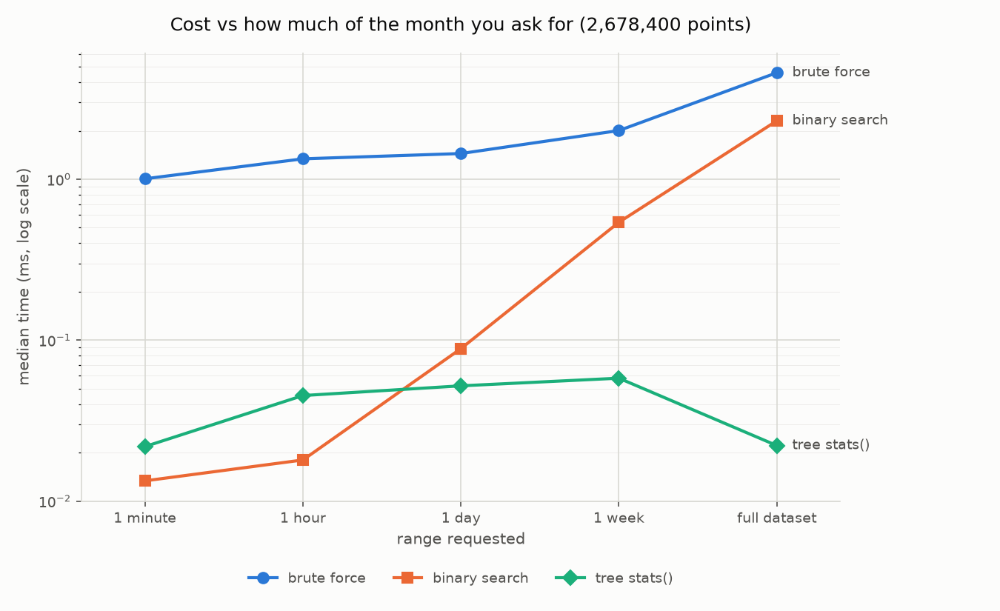

# Grid Frequency Explorer

Storing, searching and visualising a large time series quickly, using a segment tree of
precomputed summaries. Built on one month of Great Britain grid frequency data
(August 2019, 1 reading per second, 2,678,400 points).

**The question:** how many times did GB grid frequency leave its statutory limits in
August 2019, and what did the 9 August power cut look like compared with the rest of the month?

---

## Data

[NESO historic system frequency data](https://www.neso.energy/data-portal/system-frequency-data),
1-second resolution, August 2019. NESO is obliged to hold system frequency within
**±0.5 Hz of 50 Hz**, so the event band is **49.5–50.5 Hz**.

| | |
|---|---|
| Rows | 2,678,400 (31 × 86,400 — a complete calendar month) |
| Duplicate timestamps | 0 |
| Missing seconds | 0 (longest gap 0 s) |
| Value range | 48.787 – 50.274 Hz |

**The one thing that matters here is the timezone.** The raw file carries an explicit
`+0100` offset (BST), not UTC. Read naively as local time, everything shifts by an hour and
the 9 August event appears at 16:52 instead of 15:52. Everything is converted to UTC on load
and stays UTC through the API and the UI.

Gaps are kept as `NaN` and excluded from statistics — never interpolated. This file has none,
so those paths are covered only by synthetic tests.

---

## Approach

Answering "min/max/mean over this range" by scanning raw data costs O(range). Instead we
precompute summaries (`min`, `max`, `sum`, `count`) for every power-of-two window, so any
range is covered by O(log N) precomputed nodes.

```
level 0   | v0 | v1 | v2 | v3 | v4 |      N = 5   (the raw array itself)
level 1   |  v0:v2  |  v2:v4  | v4 |      ceil(5/2) = 3   (last window partial)
level 2   |      v0:v4        | v4 |      ceil(5/4) = 2
level 3   |           v0:v5        |      1 window -> stop
```

Design decisions worth noting:

- **No padding to a power of two.** N is the real length; the last window at each level may
  be partial. Padding 2,678,400 up to 4,194,304 would add ~1.5M phantom windows. The build
  appends at most *one* empty slot per level (23 total).
- **Level 0 is the raw array**, derived on demand rather than stored — saves ~32 MB of
  redundant arrays.
- **`sum` is float64** while `min`/`max` are float32: accumulating 2.7M float32 values in
  float32 visibly corrupts the mean.
- **An empty window and a real NaN gap are represented identically** (min/max NaN, count 0),
  so the partial last window needs no special case.
- Two query paths, because they answer different questions: `query()` reads one contiguous
  slice of the level whose window size fits the range into *W* points (cost tracks pixels,
  not range width), while `stats()` walks the tree bottom-up for an *exact* answer.

23 levels, 53.6 MB (5× the raw array), built in 39 ms.

---

## Results

**One event in the whole month**, found by pruning the tree — a node whose `[min, max]` fits
inside the band, or whose count is 0, is rejected whole.

| id | start (UTC) | duration | direction | extreme | at (UTC) | recovery | max RoCoF |
|---|---|---|---|---|---|---|---|
| 0 | 2019-08-09 15:52:38 | 142 s | under | **48.787 Hz** | 15:53:49 | 71 s | 0.151 Hz/s |

The search visited **323 nodes out of 2,678,400 points** (0.012%) in 1.6 ms, and returned
indices identical to a full numpy mask.

**Profile of the event** (sampled every 10 s):

```
15:52:28   50.010    nominal
15:52:38   49.468    <- leaves the band
15:52:58   49.120    first plateau
15:53:49   48.787    <- minimum; low-frequency demand disconnection trips near 48.8
15:54:58   49.487
15:55:00   49.5+     <- back inside the band
```

The two-stage decline — a plateau near 49.15, then a deeper fall — is consistent with two
generators being lost in sequence. 48.787 Hz is the month's global minimum, and the only
reading anywhere near a statutory limit: the maximum for the whole month is 50.274 Hz, so
every excursion is downward.

`max_rocof_hz_per_s` is a coarse **lower bound** — 1-second sampling cannot resolve a
transient that real RoCoF relays measure over ~500 ms windows.


<!-- TODO: screenshot of the dashboard zoomed into the 9 August event -->

---

## Performance

Median of 50 repetitions, random start positions, on the real month (2,678,400 points).
Times in ms.

| Range | brute force | binary search | tree | tree nodes |
|---|---|---|---|---|
| 1 minute | 1.007 | **0.013** | 0.022 | 7 |
| 1 hour | 1.339 | **0.018** | 0.045 | 12 |
| 1 day | 1.445 | 0.089 | **0.052** | 14 |
| 1 week | 2.007 | 0.540 | **0.058** | 18 |
| full dataset | 4.590 | 2.308 | **0.022** | 9 |



**The tree loses at narrow ranges.** For a 1-minute window `np.searchsorted` plus a numpy
reduction is ~1.7× faster — slicing 60 contiguous float32s is less work than walking 7 tree
nodes in Python. The crossover is around **1 day**; at full range the tree is ~100× faster.
This is a constant-factor result (interpreter overhead), not an algorithmic one.

**Brute force is always slow and barely varies** (1.0–4.6 ms) because it masks all 2.7M points
no matter how little you ask for. Its cost tracks the dataset, not the question.


| Points | tree build | tree (unaligned) | binary search | brute force |
|---|---|---|---|---|
| 2,678,400 | 39 ms | 0.082 (35 nodes) | 2.58 | 5.14 |
| 4,194,304 | 70 ms | 0.101 (42 nodes) | 4.25 | 8.90 |
| 16,777,216 | 297 ms | 0.110 (46 nodes) | 18.07 | 36.95 |

**Growth rate is the real argument.** 4× more data costs the baselines ~4.3× more time and
the tree ~1.3× (35 → 46 nodes). Two honest caveats:

- At a power-of-two size the full range *is* the root node, so `stats()` touches 1 node and
  finishes in 5 µs. Real but unrepresentative, so the table above reports the same span offset
  by one second, which forces the full O(log N) decomposition. Both are in `benchmarks.csv`.
- 2^26 and 2^27 were **skipped for RAM** (~40 bytes/point needed: 4 raw + 20 tree + build
  buffers). The script estimates before each size and records the skip.

Tree build is a genuine one-off cost (~15-18 ns/point). It pays for itself after roughly 8
full-range brute-force queries, and is pure overhead for data queried once.

Fairness: the baselines get an int64 epoch-ms timestamp array (their fastest option) built
outside every timed region, all methods see the same random starts, and the script asserts all
three return identical answers before timing any of them.

---

## What would break at larger scale

- **Live, appending data.** The tree is built bottom-up in one pass and cached whole. Appending
  one second means touching one node per level (cheap), but the last window at each level is
  partial and would need rewriting in place — and the cache file would have to be appendable
  rather than rewritten.
- **Out-of-order or late-arriving data.** Nothing here handles it. A late point invalidates
  every ancestor summary; you would need either a rebuild of the affected spine or a
  write-ahead buffer merged periodically.
- **Higher sample rates.** At 50 Hz instead of 1 Hz the month is 134M points and the tree is
  ~2.7 GB — past this machine's budget. The fix is to stop storing level 0 in the tree at all
  and page levels from disk (the upper levels are tiny; level 1 is half the data).
- **Thousands of streams.** One tree per stream is fine for memory *per* stream but the
  per-request Python overhead dominates — the 1-minute benchmark above is already
  interpreter-bound. This would want the walk in a compiled extension.
- **Data larger than memory.** Everything here assumes the raw array is resident. The level
  structure is naturally pageable (each level is a contiguous array), so a memory-mapped
  layout would work, but `query()` would need to respect page boundaries.

---

## How to run

Python 3.11+ (conda) and Node 20+.

```bash
conda env create -f environment.yml && conda activate grid-frequency-explorer
```

Put the NESO August 2019 file (`.csv` or `.zip`) in `data/raw/` — the data directory is not
committed.

```bash
python -m backend.loader     # inspect + cache the series   (reports data quality)
python -m backend.tree       # build + cache the tree       (reports build time, memory)
python -m backend.events     # find events -> results/events.json
python -m benchmarks.bench   # -> results/benchmarks.csv + 3 plots
pytest -q                    # 145 tests
```

Backend and dashboard, in two terminals:

```bash
python -m uvicorn backend.api:app --port 8000
cd frontend && npm install && npm run dev      # http://localhost:5173
```

The API builds any missing cache on startup and says so; if `data/raw/` is empty it aborts
with instructions rather than serving errors.

| Endpoint | Params | Returns |
|---|---|---|
| `GET /meta` | — | extent, point count, levels, band |
| `GET /query` | `start`, `end`, `width` | downsampled points for plotting |
| `GET /stats` | `start`, `end` | exact min/max/mean/count for a range |
| `GET /events` | — | the event list |

Times are epoch milliseconds UTC and ranges are half-open `[start, end)` throughout.
